# LAPORAN UJIAN TENGAH SEMESTER (UTS)
## PEMROGRAMAN BERBASIS PLATFORM (PBP)
### PENGEMBANGAN & PENYEMPURNAAN APLIKASI "JELAJAH AMAN"

---

## IDENTITAS MAHASISWA & INFORMASI KULIAH

| Parameter | Keterangan |
| :--- | :--- |
| **Nama Lengkap** | **Gathan Hilabi** |
| **NIM** | **60324059** |
| **Kelas** | **PBP A** |
| **Semester** | **5 (Lima)** |
| **Angkatan** | **2024** |
| **Program Studi** | S1 Informatika |
| **Fakultas** | Fakultas Sains dan Teknologi |
| **Perguruan Tinggi** | Universitas Islam Negeri K.H. Abdurrahman Wahid Pekalongan |
| **Mata Kuliah** | Pemrograman Berbasis Platform (4 SKS) |
| **Bobot Penilaian** | Pertemuan 8 (UTS) — Bobot 25% dari Nilai Akhir |
| **Cakupan Materi** | Pertemuan 1–7 (CPMK-1, CPMK-2, CPMK-3) |
| **Tautan Repositori GitHub** | [https://github.com/G-than12/orientasi-jelajah-aman](https://github.com/G-than12/orientasi-jelajah-aman) |

---

## DAFTAR ISI

1. [BAB I: Pendahuluan & Gambaran Umum Aplikasi](#bab-i-pendahuluan--gambaran-umum-aplikasi)
2. [BAB II: Struktur Proyek & Arsitektur Sistem](#bab-ii-struktur-proyek--arsitektur-sistem)
3. [BAB III: Tugas 1 – Kustomisasi Ikon Tab Bar & Perbaikan Label Navigasi](#bab-iii-tugas-1--kustomisasi-ikon-tab-bar--perbaikan-label-navigasi)
   - [3.5 Tangkapan Layar Hasil Implementasi (Screenshots)](#35-tangkapan-layar-hasil-implementasi-screenshots)
4. [BAB IV: Tugas 2 – Fitur Riwayat Pencarian Terakhir (Recent Search History)](#bab-iv-tugas-2--fitur-riwayat-pencarian-terakhir-recent-search-history)
   - [4.5 Tangkapan Layar Hasil Implementasi (Screenshots)](#45-tangkapan-layar-hasil-implementasi-screenshots)
5. [BAB V: Tugas 3 – Penghapusan Cache Kota & Modal Konfirmasi](#bab-v-tugas-3--penghapusan-cache-kota--modal-konfirmasi)
   - [5.5 Tangkapan Layar Hasil Implementasi (Screenshots)](#55-tangkapan-layar-hasil-implementasi-screenshots)
6. [BAB VI: Tugas 4 – Implementasi Tema Gelap / Terang / Ikuti Sistem](#bab-vi-tugas-4--implementasi-tema-gelap--terang--ikuti-sistem)
   - [6.4 Cara Kerja & Kode Logika "Ikuti Tema Sistem"](#64-cara-kerja--kode-logika-ikuti-tema-sistem-contextspengaturancontexttsx)
   - [6.6 Tombol Sakelar Cepat di Header Kanan Atas](#66-tombol-sakelar-cepat-di-pojok-kanan-atas-header-animatedthemetoggle)
   - [6.7 Tangkapan Layar Hasil Implementasi (Screenshots)](#67-tangkapan-layar-hasil-implementasi-screenshots)
7. [BAB VII: Fitur Tambahan & Nilai Plus (Kreativitas Mahasiswa)](#bab-vii-fitur-tambahan--nilai-plus-kreativitas-mahasiswa)
   - [7.1 Fitur Konversi Satuan Suhu Dinamis (Celsius vs Fahrenheit)](#71-fitur-konversi-satuan-suhu-dinamis-celsius-vs-fahrenheit)
   - [7.6 Tangkapan Layar Hasil Implementasi (Screenshots)](#76-tangkapan-layar-hasil-implementasi-screenshots)
8. [BAB VIII: Riwayat Commit Git (28++ Commits)](#bab-viii-riwayat-commit-git-28-commits)
9. [BAB IX: Kesimpulan & Penutup](#bab-ix-kesimpulan--penutup)
10. [BAB X: Daftar Pustaka](#bab-x-daftar-pustaka)

---

## BAB I: PENDAHULUAN & GAMBARAN UMUM APLIKASI

### 1.1 Latar Belakang
Aplikasi **"Jelajah Aman"** adalah aplikasi mobile berbasis *cross-platform* (Android, iOS, dan Web) yang dirancang untuk membantu masyarakat dan pelancong memantau kondisi cuaca real-time, indeks kualitas udara (*Air Quality Index* - AQI), parameter polutan partikulat ($PM_{2.5}$ dan $PM_{10}$), serta kecepatan angin di berbagai wilayah. 

Dalam rangka Ujian Tengah Semester (UTS) Praktikum Pemrograman Berbasis Platform, dilakukan penyempurnaan menyeluruh terhadap antarmuka pengguna (*User Interface*), pengalaman pengguna (*User Experience*), manajemen *state*, persistensi penyimpanan lokal (*Local Storage* dan *SQLite*), serta mekanisme *offline-first* agar aplikasi dapat diandalkan bahkan tanpa koneksi internet.

### 1.2 Tujuan Penyempurnaan UTS
Berdasarkan dokumen panduan UTS, terdapat 4 tugas pokok yang wajib diimplementasikan:
1. **Kustomisasi Ikon Tab Bar & Label Navigasi**: Mengganti ikon bawaan segitiga seragam dengan pustaka ikon representatif `@expo/vector-icons` (`Ionicons`) serta merapikan hierarki navigasi.
2. **Fitur Riwayat Pencarian Terakhir**: Menyimpan riwayat pencarian kota pengguna hingga maksimal 10 kota menggunakan penyimpanan lokal perangkat (`AsyncStorage`), lengkap dengan kemampuan memilih kembali kota tersebut untuk langsung memunculkan cuacanya.
3. **Penghapusan Cache Kota**: Menambahkan kemampuan menghapus cache kota offline (baik di Beranda maupun Pengaturan) yang dilengkapi dialog konfirmasi interaktif sebelum data dihapus dari database lokal.
4. **Implementasi Tema Gelap / Terang (*Dark/Light Mode*)**: Menyediakan opsi tema Terang, Gelap, atau Otomatis Mengikuti Sistem perangkat, serta memastikan perubahan warna terpropagasi dinamis ke seluruh layar.

---

## BAB II: STRUKTUR PROYEK & ARSITEKTUR SISTEM

Aplikasi dibangun menggunakan ekosistem **Expo (React Native)** dengan file-based router **Expo Router**, bahasa pemrograman **TypeScript**, serta database lokal **SQLite** (`expo-sqlite`) dan **AsyncStorage** (`@react-native-async-storage/async-storage`).

```
orientasi-jelajah-aman/
├── app/
│   ├── _layout.tsx              # Root Stack Layout, Font Loading, & Global Providers
│   ├── (tabs)/                  # Group Route Tab Bar Navigasi Utama
│   │   ├── _layout.tsx          # TabLayout (Custom Tab Bar Icons, Labels, Theme Header)
│   │   ├── index.tsx            # Layar Beranda (Search, GPS, Offline List, Weather Card)
│   │   ├── riwayat.tsx          # Layar Aktivitas (Riwayat Pencarian & Daftar Favorit)
│   │   ├── pengaturan.tsx       # Layar Pengaturan (Satuan Suhu, Tema, Hapus Cache)
│   │   └── tentang.tsx          # Layar Informasi Aplikasi & Pengembang
│   ├── detail/[kota].tsx        # Layar Detail Cuaca & Kualitas Udara Lengkap
│   └── tambah-favorit.tsx       # Modal Dialog Tambah Kota Favorit
├── components/
│   ├── AnimatedThemeToggle.tsx  # Toggle Sakelar Animasi Matahari/Bulan
│   ├── AtribusiCuaca.tsx        # Komponen Hak Cipta & Sumber Data Open-Meteo
│   ├── CircularThemeOverlay.tsx  # Efek Transisi Layar Melingkar (Circular Reveal)
│   ├── IndikatorAQI.tsx         # Kartu Metrik Indeks Kualitas Udara
│   ├── RiwayatList.tsx          # Komponen Presentasional Daftar Riwayat
│   ├── SearchBox.tsx            # Input Kotak Pencarian Kota (Live Search)
│   └── WeatherCard.tsx          # Kartu Cuaca Utama dengan Status Data Terpadu
├── constants/
│   ├── styles.ts                # Token Tipografi (Plus Jakarta Sans) & Spacing
│   ├── theme.ts                 # Palet Warna Atmospheric Indigo & Electric Sky
│   └── weatherCodes.ts          # Pemetaan WMO Weather Codes ke Ikon & Label
├── contexts/
│   ├── PengaturanContext.tsx    # State Management Global untuk Tema & Preferensi
│   └── RiwayatContext.tsx       # State Management Global untuk Riwayat Pencarian
├── services/
│   ├── cacheRepository.ts       # Service CRUD Cache Cuaca SQLite Offline-First
│   ├── cuacaRepository.ts       # Strategi Pengambilan Data Offline-First
│   ├── favoritStorage.ts        # Service Manajemen Kota Favorit di Storage
│   ├── geocodingService.ts      # Integrasi Geocoding API Open-Meteo
│   ├── locationService.ts       # Integrasi GPS & Lokasi Geografis (expo-location)
│   └── weatherAdapter.ts        # Transformasi Payload API Cuaca & Kualitas Udara
└── package.json                 # Konfigurasi Dependensi & Skrip Proyek
```

---

## BAB III: TUGAS 1 – KUSTOMISASI IKON TAB BAR & PERBAIKAN LABEL NAVIGASI

### 3.1 Analisis Kebutuhan
Pada kondisi awal praktikum, navigasi bawah Expo Router Tabs masih menggunakan ikon bawaan segitiga (`TabBarIcon` default) yang seragam di seluruh tab, dan penamaan label belum terorganisir dengan jelas antara data favorit, riwayat pencarian, dan pengaturan sistem.

### 3.2 Langkah-Langkah Solusi
1. Mengimpor pustaka `@expo/vector-icons` khususnya keluarga ikon `Ionicons`.
2. Mengganti ikon seragam dengan ikon adaptif yang memiliki status *focused* (ikon solid) dan *unfocused* (ikon outline):
   - **Beranda**: `home` / `home-outline`
   - **Aktivitas (Riwayat & Favorit)**: `time` / `time-outline`
   - **Pengaturan**: `settings` / `settings-outline`
   - **Tentang**: `information-circle` / `information-circle-outline`
3. Merapikan label navigasi agar fungsi peninjauan data favorit dan riwayat pencarian disatukan dalam satu tab intuitif bernama **"Aktivitas"** dengan switch kapsul internal.
4. Menghubungkan warna aktif (`tabBarActiveTintColor`) dan latar belakang tab bar secara dinamis ke token tema sistem (`theme.tabBarActive`, `theme.tabBar`, `theme.tabBarBorder`).
5. Memasang tombol sakelar tema adaptif (`AnimatedThemeToggle`) langsung pada `headerRight` di tab bar atas.

### 3.3 Potongan Kode Program Asli (`app/(tabs)/_layout.tsx`)

Berikut adalah bukti visual tangkapan layar editor kode program asli implementasi navigasi tab bar dan kustomisasi ikon `Ionicons`:

<div align="center">

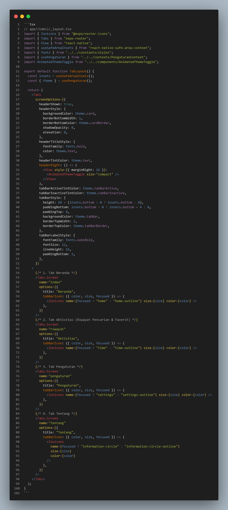

*Gambar 3.1: Tangkapan layar kode implementasi navigasi Tab Bar pada app/(tabs)/_layout.tsx*

</div>

Cuplikan teks kode program:

```tsx
// app/(tabs)/_layout.tsx
import { Ionicons } from "@expo/vector-icons";
import { Tabs } from "expo-router";
import { View } from "react-native";
import { useSafeAreaInsets } from "react-native-safe-area-context";
import { fonts } from "../../constants/styles";
import { usePengaturan } from "../../contexts/PengaturanContext";
import AnimatedThemeToggle from "../../components/AnimatedThemeToggle";

export default function TabLayout() {
  const insets = useSafeAreaInsets();
  const { theme } = usePengaturan();

  return (
    <Tabs
      screenOptions={{
        headerShown: true,
        headerStyle: {
          backgroundColor: theme.card,
          borderBottomWidth: 1,
          borderBottomColor: theme.cardBorder,
          shadowOpacity: 0,
          elevation: 0,
        },
        headerTitleStyle: {
          fontFamily: fonts.bold,
          color: theme.text,
        },
        headerTintColor: theme.text,
        headerRight: () => (
          <View style={{ marginRight: 16 }}>
            <AnimatedThemeToggle size="compact" />
          </View>
        ),
        tabBarActiveTintColor: theme.tabBarActive,
        tabBarInactiveTintColor: theme.tabBarInactive,
        tabBarStyle: {
          height: 68 + (insets.bottom > 0 ? insets.bottom : 8),
          paddingBottom: insets.bottom > 0 ? insets.bottom + 4 : 8,
          paddingTop: 8,
          backgroundColor: theme.tabBar,
          borderTopWidth: 1,
          borderTopColor: theme.tabBarBorder,
        },
        tabBarLabelStyle: {
          fontFamily: fonts.semiBold,
          fontSize: 12,
          lineHeight: 16,
          paddingBottom: 2,
        },
      }}
    >
      {/* 1. Tab Beranda */}
      <Tabs.Screen
        name="index"
        options={{
          title: "Beranda",
          tabBarIcon: ({ color, size, focused }) => (
            <Ionicons name={focused ? "home" : "home-outline"} size={size} color={color} />
          ),
        }}
      />
      {/* 2. Tab Aktivitas (Riwayat Pencarian & Favorit) */}
      <Tabs.Screen
        name="riwayat"
        options={{
          title: "Aktivitas",
          tabBarIcon: ({ color, size, focused }) => (
            <Ionicons name={focused ? "time" : "time-outline"} size={size} color={color} />
          ),
        }}
      />
      {/* 3. Tab Pengaturan */}
      <Tabs.Screen
        name="pengaturan"
        options={{
          title: "Pengaturan",
          tabBarIcon: ({ color, size, focused }) => (
            <Ionicons name={focused ? "settings" : "settings-outline"} size={size} color={color} />
          ),
        }}
      />
      {/* 4. Tab Tentang */}
      <Tabs.Screen
        name="tentang"
        options={{
          title: "Tentang",
          tabBarIcon: ({ color, size, focused }) => (
            <Ionicons
              name={focused ? "information-circle" : "information-circle-outline"}
              size={size}
              color={color}
            />
          ),
        }}
      />
    </Tabs>
  );
}
```

### 3.4 Penjelasan Teknis
- **`useSafeAreaInsets()`**: Menghitung area aman bagian bawah layar perangkat (terutama iPhone ber-notch atau Android dengan *gesture navigation bar*), sehingga teks label tab bar tidak akan terpotong pada berbagai dimensi layar.
- **Ikon Dinamis (`focused ? ... : ...`)**: Saat pengguna berada di tab aktif, ikon bertransformasi menjadi *solid fill* untuk memberikan feedback visual yang tegas kepada pengguna.

### 3.5 Tangkapan Layar Hasil Implementasi (Screenshots)

Berikut adalah bukti visual implementasi kustomisasi ikon tab bar dan label navigasi:

<div align="center">

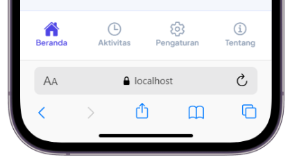

*Gambar 3.2: Navigasi Tab Bar bawah dengan ikon kustom Ionicons (`Beranda`, `Aktivitas`, `Pengaturan`, `Tentang`)*

</div>

> [!NOTE]
> Aset tangkapan layar navigasi tab bar tersimpan pada: `docs/screenshots/01_tab_bar_navigation.png`.

---

## BAB IV: TUGAS 2 – FITUR RIWAYAT PENCARIAN TERAKHIR (RECENT SEARCH HISTORY)

### 4.1 Analisis Kebutuhan
Aplikasi wajib menyimpan data kota yang dicari pengguna secara otomatis ke penyimpanan lokal perangkat dengan ketentuan:
1. Kapasitas riwayat dibatasi maksimal **10 pencarian terakhir**.
2. Mekanisme pengurutan menggunakan prinsip **LIFO (*Last In, First Out*)** dan **Deduplikasi**: apabila pengguna mencari kota yang sebelumnya sudah ada di riwayat, posisi kota tersebut akan dipindahkan ke baris paling atas tanpa menduplikasi data.
3. Saat item riwayat diklik di tab Aktivitas, aplikasi harus langsung menavigasikan pengguna untuk memunculkan data cuaca kota tersebut.

### 4.2 Langkah-Langkah Solusi
1. Membuat modul Context API `RiwayatContext.tsx` untuk mengelola state global daftar riwayat pencarian.
2. Mengintegrasikan pustaka `@react-native-async-storage/async-storage` dengan kunci penyimpanan `@jelajah_aman:riwayat_pencarian`.
3. Memanggil fungsi `tambahRiwayat()` setiap kali pengguna memilih kota melalui kotak pencarian atau GPS di layar Beranda (`index.tsx`).
4. Pada layar `app/(tabs)/riwayat.tsx`, merender daftar riwayat menggunakan kartu interaktif yang memiliki tombol hapus individual dan fungsi klik untuk navigasi langsung ke halaman Detail Cuaca (`/detail/[kota]`).

### 4.3 Potongan Kode Program Asli State Management (`contexts/RiwayatContext.tsx`)

Berikut adalah bukti visual tangkapan layar editor kode program asli implementasi context riwayat pencarian berbasis `AsyncStorage`:

<div align="center">

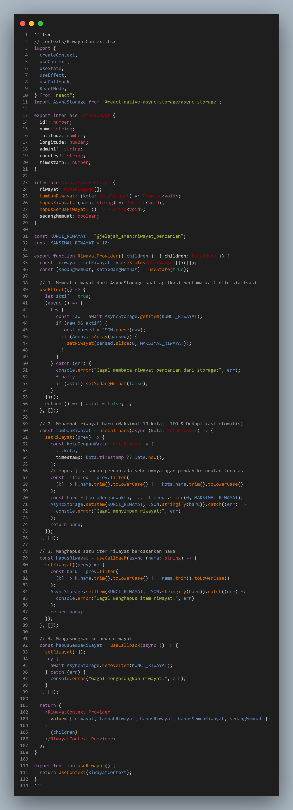

*Gambar 4.1: Tangkapan layar kode state management RiwayatContext.tsx*

</div>

Cuplikan teks kode program:

```tsx
// contexts/RiwayatContext.tsx
import {
  createContext,
  useContext,
  useState,
  useEffect,
  useCallback,
  ReactNode,
} from "react";
import AsyncStorage from "@react-native-async-storage/async-storage";

export interface KotaRiwayat {
  id?: number;
  name: string;
  latitude: number;
  longitude: number;
  admin1?: string;
  country?: string;
  timestamp?: number;
}

interface RiwayatContextType {
  riwayat: KotaRiwayat[];
  tambahRiwayat: (kota: KotaRiwayat) => Promise<void>;
  hapusRiwayat: (nama: string) => Promise<void>;
  hapusSemuaRiwayat: () => Promise<void>;
  sedangMemuat: boolean;
}

const KUNCI_RIWAYAT = "@jelajah_aman:riwayat_pencarian";
const MAKSIMAL_RIWAYAT = 10;

export function RiwayatProvider({ children }: { children: ReactNode }) {
  const [riwayat, setRiwayat] = useState<KotaRiwayat[]>([]);
  const [sedangMemuat, setSedangMemuat] = useState(true);

  // 1. Memuat riwayat dari AsyncStorage saat aplikasi pertama kali diinisialisasi
  useEffect(() => {
    let aktif = true;
    (async () => {
      try {
        const raw = await AsyncStorage.getItem(KUNCI_RIWAYAT);
        if (raw && aktif) {
          const parsed = JSON.parse(raw);
          if (Array.isArray(parsed)) {
            setRiwayat(parsed.slice(0, MAKSIMAL_RIWAYAT));
          }
        }
      } catch (err) {
        console.error("Gagal membaca riwayat pencarian dari storage:", err);
      } finally {
        if (aktif) setSedangMemuat(false);
      }
    })();
    return () => { aktif = false; };
  }, []);

  // 2. Menambah riwayat baru (Maksimal 10 kota, LIFO & Deduplikasi otomatis)
  const tambahRiwayat = useCallback(async (kota: KotaRiwayat) => {
    setRiwayat((prev) => {
      const kotaDenganWaktu: KotaRiwayat = {
        ...kota,
        timestamp: kota.timestamp ?? Date.now(),
      };
      // Hapus jika sudah pernah ada sebelumnya agar pindah ke urutan teratas
      const filtered = prev.filter(
        (k) => k.name.trim().toLowerCase() !== kota.name.trim().toLowerCase()
      );
      const baru = [kotaDenganWaktu, ...filtered].slice(0, MAKSIMAL_RIWAYAT);
      AsyncStorage.setItem(KUNCI_RIWAYAT, JSON.stringify(baru)).catch((err) =>
        console.error("Gagal menyimpan riwayat:", err)
      );
      return baru;
    });
  }, []);

  // 3. Menghapus satu item riwayat berdasarkan nama
  const hapusRiwayat = useCallback(async (nama: string) => {
    setRiwayat((prev) => {
      const baru = prev.filter(
        (k) => k.name.trim().toLowerCase() !== nama.trim().toLowerCase()
      );
      AsyncStorage.setItem(KUNCI_RIWAYAT, JSON.stringify(baru)).catch((err) =>
        console.error("Gagal menghapus item riwayat:", err)
      );
      return baru;
    });
  }, []);

  // 4. Mengosongkan seluruh riwayat
  const hapusSemuaRiwayat = useCallback(async () => {
    setRiwayat([]);
    try {
      await AsyncStorage.removeItem(KUNCI_RIWAYAT);
    } catch (err) {
      console.error("Gagal mengosongkan riwayat:", err);
    }
  }, []);

  return (
    <RiwayatContext.Provider
      value={{ riwayat, tambahRiwayat, hapusRiwayat, hapusSemuaRiwayat, sedangMemuat }}
    >
      {children}
    </RiwayatContext.Provider>
  );
}

export function useRiwayat() {
  return useContext(RiwayatContext);
}
```

### 4.4 Potongan Kode Integrasi & Interaktivitas Klik (`app/(tabs)/riwayat.tsx`)

Berikut adalah bukti visual tangkapan layar editor kode antarmuka riwayat dan penanganan klik item:

<div align="center">

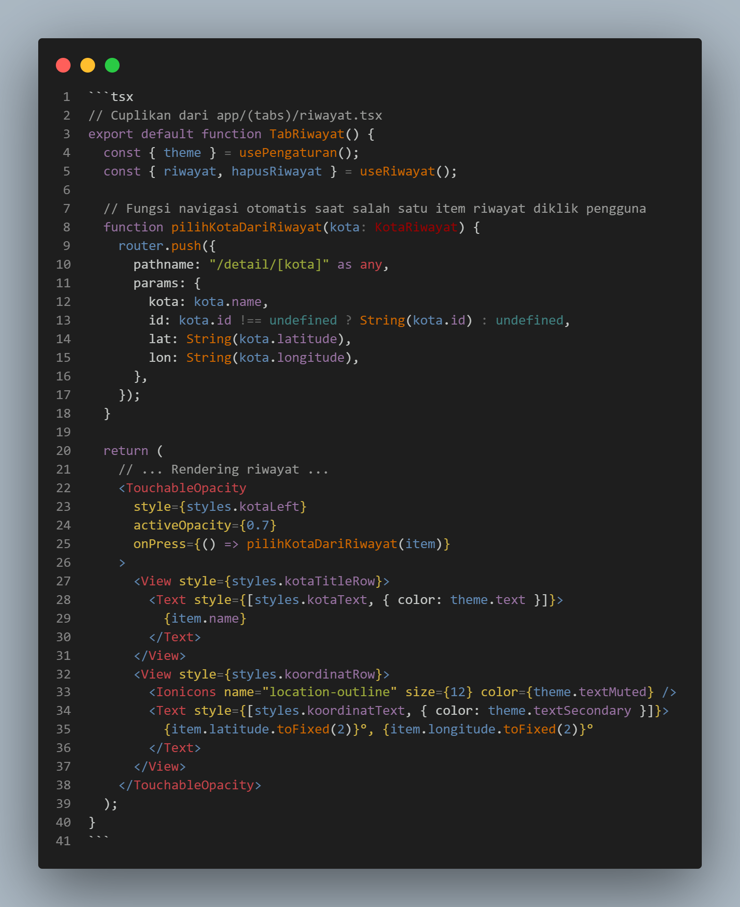

*Gambar 4.2: Tangkapan layar kode layar aktivitas riwayat pencarian pada app/(tabs)/riwayat.tsx*

</div>

Cuplikan teks kode program:

```tsx
// Cuplikan dari app/(tabs)/riwayat.tsx
export default function TabRiwayat() {
  const { theme } = usePengaturan();
  const { riwayat, hapusRiwayat } = useRiwayat();

  // Fungsi navigasi otomatis saat salah satu item riwayat diklik pengguna
  function pilihKotaDariRiwayat(kota: KotaRiwayat) {
    router.push({
      pathname: "/detail/[kota]" as any,
      params: {
        kota: kota.name,
        id: kota.id !== undefined ? String(kota.id) : undefined,
        lat: String(kota.latitude),
        lon: String(kota.longitude),
      },
    });
  }

  return (
    // ... Rendering riwayat ...
    <TouchableOpacity
      style={styles.kotaLeft}
      activeOpacity={0.7}
      onPress={() => pilihKotaDariRiwayat(item)}
    >
      <View style={styles.kotaTitleRow}>
        <Text style={[styles.kotaText, { color: theme.text }]}>
          {item.name}
        </Text>
      </View>
      <View style={styles.koordinatRow}>
        <Ionicons name="location-outline" size={12} color={theme.textMuted} />
        <Text style={[styles.koordinatText, { color: theme.textSecondary }]}>
          {item.latitude.toFixed(2)}°, {item.longitude.toFixed(2)}°
        </Text>
      </View>
    </TouchableOpacity>
  );
}
```

### 4.5 Tangkapan Layar Hasil Implementasi (Screenshots)

Berikut adalah bukti visual implementasi fitur riwayat pencarian terakhir dan interaktivitasnya:

<div align="center">

| Riwayat Pencarian Terakhir (Tab Aktivitas) | Hasil Navigasi Saat Riwayat Diklik (Detail Cuaca) |
| :---: | :---: |
| 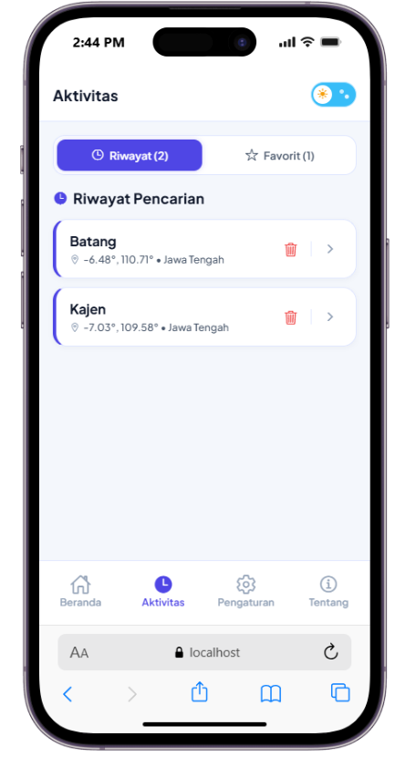 |  |
| *Gambar 4.3: Daftar riwayat pencarian (maksimal 10 item, LIFO & deduplikasi)* | *Gambar 4.4: Tampilan detail informasi cuaca setelah salah satu riwayat diklik* |

</div>

> [!NOTE]
> Aset tangkapan layar fitur riwayat pencarian tersimpan pada: `docs/screenshots/02_riwayat_pencarian.png` dan `docs/screenshots/02_riwayat_klik_detail.png`.

---

## BAB V: TUGAS 3 – PENGHAPUSAN CACHE KOTA & MODAL KONFIRMASI

### 5.1 Analisis Kebutuhan
Pada pertemuan 7, aplikasi menerapkan strategi *offline-first* menggunakan SQLite lokal (`cache_cuaca`). Tugas UTS nomor 3 mewajibkan:
1. Tombol hapus cache pada setiap item kota tersimpan/offline.
2. Dialog konfirmasi (*Confirmation Alert*) sebelum data cache dihapus secara permanen dari perangkat, untuk menghindari kehilangan data yang tidak disengaja.

### 5.2 Langkah-Langkah Solusi
1. Membuat fungsi query SQLite di `src/services/cacheRepository.ts`:
   - `hapusCacheKota(kunci, namaKota)`: Menghapus baris cache spesifik berdasarkan koordinat (`kunci`) atau nama kota.
   - `hapusSemuaCache()`: Menghapus seluruh rekaman cache SQLite dari menu Pengaturan.
2. Merancang komponen Modal Dialog konfirmasi custom yang serasi dengan desain modern (bukan sekadar `Alert.alert` bawaan sistem yang memiliki keterbatasan tampilan dan tidak konsisten di platform web).
3. Mengimplementasikan *Optimistic UI Update*: saat pengguna menekan tombol konfirmasi "Hapus", state daftar kota di layar langsung dimutakhirkan secara instan, disusul eksekusi query SQLite di latar belakang.

### 5.3 Potongan Kode Program Asli SQLite Service (`src/services/cacheRepository.ts`)

Berikut adalah bukti visual tangkapan layar editor kode layanan SQLite untuk penghapusan cache offline:

<div align="center">

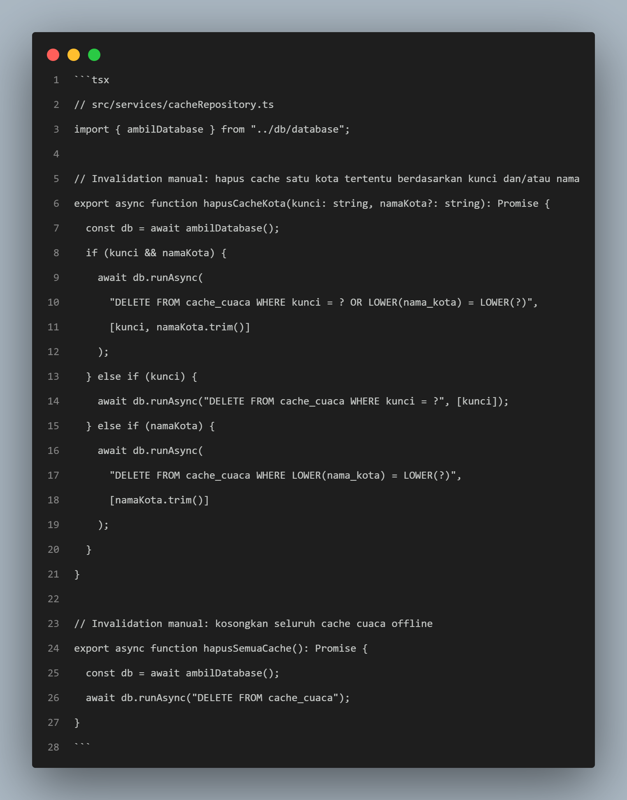

*Gambar 5.1: Tangkapan layar kode fungsi penghapusan cache pada src/services/cacheRepository.ts*

</div>

Cuplikan teks kode program:

```tsx
// src/services/cacheRepository.ts
import { ambilDatabase } from "../db/database";

// Invalidation manual: hapus cache satu kota tertentu berdasarkan kunci dan/atau nama
export async function hapusCacheKota(kunci: string, namaKota?: string): Promise<void> {
  const db = await ambilDatabase();
  if (kunci && namaKota) {
    await db.runAsync(
      "DELETE FROM cache_cuaca WHERE kunci = ? OR LOWER(nama_kota) = LOWER(?)",
      [kunci, namaKota.trim()]
    );
  } else if (kunci) {
    await db.runAsync("DELETE FROM cache_cuaca WHERE kunci = ?", [kunci]);
  } else if (namaKota) {
    await db.runAsync(
      "DELETE FROM cache_cuaca WHERE LOWER(nama_kota) = LOWER(?)",
      [namaKota.trim()]
    );
  }
}

// Invalidation manual: kosongkan seluruh cache cuaca offline
export async function hapusSemuaCache(): Promise<void> {
  const db = await ambilDatabase();
  await db.runAsync("DELETE FROM cache_cuaca");
}
```

### 5.4 Potongan Kode Modal Konfirmasi Hapus Cache (`app/(tabs)/index.tsx`)

Berikut adalah bukti visual tangkapan layar editor kode modal konfirmasi hapus cache:

<div align="center">

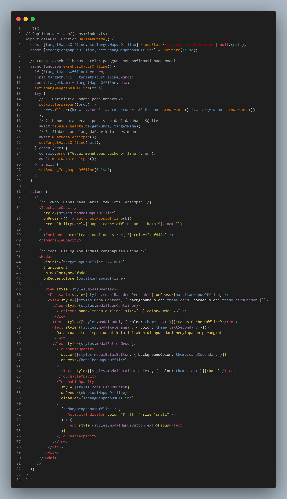

*Gambar 5.2: Tangkapan layar kode modal dialog konfirmasi hapus cache pada app/(tabs)/index.tsx*

</div>

Cuplikan teks kode program:

```tsx
// Cuplikan dari app/(tabs)/index.tsx
export default function HalamanUtama() {
  const [targetHapusOffline, setTargetHapusOffline] = useState<RingkasanKotaTersimpan | null>(null);
  const [sedangMenghapusOffline, setSedangMenghapusOffline] = useState(false);

  // Fungsi eksekusi hapus setelah pengguna mengonfirmasi pada Modal
  async function eksekusiHapusOffline() {
    if (!targetHapusOffline) return;
    const targetKunci = targetHapusOffline.kunci;
    const targetNama = targetHapusOffline.nama;
    setSedangMenghapusOffline(true);
    try {
      // 1. Optimistic update pada antarmuka
      setKotaTersimpan((prev) =>
        prev.filter((k) => k.kunci !== targetKunci && k.nama.toLowerCase() !== targetNama.toLowerCase())
      );
      // 2. Hapus data secara persisten dari database SQLite
      await hapusCacheKota(targetKunci, targetNama);
      // 3. Sinkronkan ulang daftar kota tersimpan
      await muatKotaTersimpan();
      setTargetHapusOffline(null);
    } catch (err) {
      console.error("Gagal menghapus cache offline:", err);
      await muatKotaTersimpan();
    } finally {
      setSedangMenghapusOffline(false);
    }
  }

  return (
    <>
      {/* Tombol Hapus pada Baris Item Kota Tersimpan */}
      <TouchableOpacity
        style={styles.tombolHapusOffline}
        onPress={() => setTargetHapusOffline(k)}
        accessibilityLabel={`Hapus cache offline untuk kota ${k.nama}`}
      >
        <Ionicons name="trash-outline" size={15} color="#ef4444" />
      </TouchableOpacity>

      {/* Modal Dialog Konfirmasi Penghapusan Cache */}
      <Modal
        visible={targetHapusOffline !== null}
        transparent
        animationType="fade"
        onRequestClose={batalkanHapusOffline}
      >
        <View style={styles.modalOverlay}>
          <Pressable style={styles.modalBackdropPressable} onPress={batalkanHapusOffline} />
          <View style={[styles.modalContent, { backgroundColor: theme.card, borderColor: theme.cardBorder }]}>
            <View style={styles.modalIconContainer}>
              <Ionicons name="trash-outline" size={28} color="#dc2626" />
            </View>
            <Text style={[styles.modalJudul, { color: theme.text }]}>Hapus Cache Offline?</Text>
            <Text style={[styles.modalKeterangan, { color: theme.textSecondary }]}>
              Data cuaca tersimpan untuk kota ini akan dihapus dari penyimpanan perangkat.
            </Text>
            <View style={styles.modalButtonGroup}>
              <TouchableOpacity
                style={[styles.modalBatalButton, { backgroundColor: theme.cardSecondary }]}
                onPress={batalkanHapusOffline}
              >
                <Text style={[styles.modalBatalButtonText, { color: theme.text }]}>Batal</Text>
              </TouchableOpacity>
              <TouchableOpacity
                style={styles.modalHapusButton}
                onPress={eksekusiHapusOffline}
                disabled={sedangMenghapusOffline}
              >
                {sedangMenghapusOffline ? (
                  <ActivityIndicator color="#ffffff" size="small" />
                ) : (
                  <Text style={styles.modalHapusButtonText}>Hapus</Text>
                )}
              </TouchableOpacity>
            </View>
          </View>
        </View>
      </Modal>
    </>
  );
}
```

### 5.5 Tangkapan Layar Hasil Implementasi (Screenshots)

Berikut adalah bukti visual implementasi penghapusan cache kota offline beserta dialog modal konfirmasi interaktif:

<div align="center">

| Tombol Hapus Cache pada Kartu Kota Tersimpan | Dialog Modal Konfirmasi Interaktif |
| :---: | :---: |
|  | 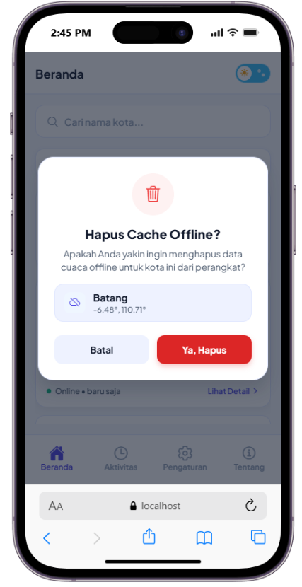 |
| *Gambar 5.3: Tombol tempat sampah merah pada kartu cuaca tersimpan (offline)* | *Gambar 5.4: Modal konfirmasi "Hapus Cache Offline?" dengan tombol Batal & Hapus* |

</div>

> [!NOTE]
> Aset tangkapan layar fitur penghapusan cache dan modal konfirmasi tersimpan pada: `docs/screenshots/03_tombol_hapus_cache.png` dan `docs/screenshots/03_modal_konfirmasi_hapus.png`.

---

## BAB VI: TUGAS 4 – IMPLEMENTASI TEMA GELAP / TERANG / IKUTI SISTEM

### 6.1 Analisis Kebutuhan
Aplikasi standar hanya memiliki satu warna statis. Tugas UTS nomor 4 mewajibkan:
1. Pilihan mode tampilan di menu Pengaturan: **Terang (Light)**, **Gelap (Dark)**, atau **Ikuti Sistem (Automatic)**.
2. Perubahan warna yang diterapkan secara dinamis dan menyeluruh ke seluruh layar (`Beranda`, `Aktivitas`, `Pengaturan`, `Tentang`, `Detail Cuaca`, dan `Modal Tambah Favorit`).

### 6.2 Langkah-Langkah Solusi
1. Mendefinisikan struktur interface `ThemeColors` dan memetakan palet warna **Atmospheric Indigo & Electric Sky** di `constants/theme.ts`.
2. Membangun Context API `PengaturanContext.tsx` yang mendengarkan perubahan warna sistem perangkat melalui hook `useColorScheme()` dari React Native.
3. Menyimpan preferensi pengguna (apakah memilih manual atau otomatis mengikuti sistem) ke dalam `AsyncStorage` agar pilihan tetap tersimpan saat aplikasi ditutup dan dibuka kembali.
4. Menyediakan antarmuka sakelar (*Switch*) di menu Pengaturan (`app/(tabs)/pengaturan.tsx`).
5. Menyediakan animasi transisi melingkar (*Circular Reveal Animation*) saat tema berganti melalui `CircularThemeOverlay.tsx` dan tombol sakelar visual `AnimatedThemeToggle.tsx`.

### 6.3 Potongan Kode Program Asli Token Tema (`constants/theme.ts`)

Berikut adalah bukti visual tangkapan layar editor kode definisi token palet tema Atmospheric Indigo dan Electric Sky:

<div align="center">

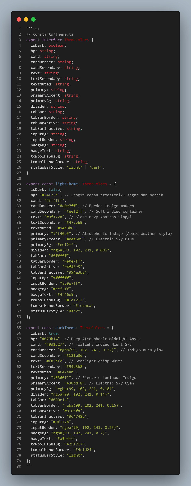

*Gambar 6.1: Tangkapan layar kode palet tema Atmospheric Indigo pada constants/theme.ts*

</div>

Cuplikan teks kode program:

```tsx
// constants/theme.ts
export interface ThemeColors {
  isDark: boolean;
  bg: string;
  card: string;
  cardBorder: string;
  cardSecondary: string;
  text: string;
  textSecondary: string;
  textMuted: string;
  primary: string;
  primaryAccent: string;
  primaryBg: string;
  divider: string;
  tabBar: string;
  tabBarBorder: string;
  tabBarActive: string;
  tabBarInactive: string;
  inputBg: string;
  inputBorder: string;
  badgeBg: string;
  badgeText: string;
  tombolHapusBg: string;
  tombolHapusBorder: string;
  statusBarStyle: "light" | "dark";
}

export const lightTheme: ThemeColors = {
  isDark: false,
  bg: "#f4f7fc", // Langit cerah atmosferik, segar dan bersih
  card: "#ffffff",
  cardBorder: "#e0e7ff", // Border indigo modern
  cardSecondary: "#eef2ff", // Soft indigo container
  text: "#0f172a", // Slate navy kontras tinggi
  textSecondary: "#475569",
  textMuted: "#94a3b8",
  primary: "#4f46e5", // Atmospheric Indigo (Apple Weather style)
  primaryAccent: "#0ea5e9", // Electric Sky Blue
  primaryBg: "#eef2ff",
  divider: "rgba(99, 102, 241, 0.08)",
  tabBar: "#ffffff",
  tabBarBorder: "#e0e7ff",
  tabBarActive: "#4f46e5",
  tabBarInactive: "#94a3b8",
  inputBg: "#ffffff",
  inputBorder: "#e0e7ff",
  badgeBg: "#eef2ff",
  badgeText: "#4f46e5",
  tombolHapusBg: "#fef2f2",
  tombolHapusBorder: "#fecaca",
  statusBarStyle: "dark",
};

export const darkTheme: ThemeColors = {
  isDark: true,
  bg: "#070b14", // Deep Atmospheric Midnight Abyss
  card: "#0d1527", // Twilight Indigo Night Sky
  cardBorder: "rgba(99, 102, 241, 0.22)", // Indigo aura glow
  cardSecondary: "#131e36",
  text: "#f8fafc", // Starlight crisp white
  textSecondary: "#94a3b8",
  textMuted: "#64748b",
  primary: "#6366f1", // Electric Luminous Indigo
  primaryAccent: "#38bdf8", // Electric Sky Cyan
  primaryBg: "rgba(99, 102, 241, 0.18)",
  divider: "rgba(99, 102, 241, 0.14)",
  tabBar: "#090e1a",
  tabBarBorder: "rgba(99, 102, 241, 0.16)",
  tabBarActive: "#818cf8",
  tabBarInactive: "#64748b",
  inputBg: "#0f172a",
  inputBorder: "rgba(99, 102, 241, 0.25)",
  badgeBg: "rgba(99, 102, 241, 0.2)",
  badgeText: "#a5b4fc",
  tombolHapusBg: "#251217",
  tombolHapusBorder: "#4c1d24",
  statusBarStyle: "light",
};
```

### 6.4 Cara Kerja & Kode Logika "Ikuti Tema Sistem" (`contexts/PengaturanContext.tsx`)

Fitur **"Ikuti Tema Sistem"** memungkinkan aplikasi menyelaraskan tampilannya secara otomatis dengan mode tema global yang sedang aktif pada sistem operasi perangkat (Android / iOS):

1. **Deteksi Sistem Operasi Real-Time**:
   - Menggunakan hook bawaan React Native `useColorScheme()` yang mendengarkan (*event listener*) status tampilan perangkat.
   - Nilai kembalian `temaSistem` bertipe `'light' | 'dark' | null`.
2. **Hierarki Keputusan Tema (*Decision Hierarchy*)**:
   - Logika penentuan tema aktif dievaluasi melalui ekspresi kondisional:
     ```typescript
     const isDark = preferensi.ikutiSistem ? temaSistem === "dark" : preferensi.darkMode;
     ```
   - **Kondisi 1 (Ikuti Sistem Aktif)**: Jika `preferensi.ikutiSistem === true`, maka nilai `isDark` sepenuhnya mengikuti kondisi OS. Bila pengguna mengaktifkan mode gelap di notification shade HP mereka, seluruh antarmuka aplikasi Jelajah Aman otomatis berubah menjadi gelap tanpa perlu memuat ulang aplikasi.
   - **Kondisi 2 (Mode Manual)**: Jika `preferensi.ikutiSistem === false`, maka nilai `isDark` ditentukan secara mandiri oleh `preferensi.darkMode` yang dipilih langsung oleh pengguna.
3. **Persistensi Penyimpanan Lokal (`AsyncStorage`)**:
   - Preferensi tema disimpan secara persisten dengan kunci `@jelajah_aman:preferensi` dalam format JSON, sehingga saat aplikasi ditutup dan dibuka kembali, preferensi pengguna tetap dipertahankan.

Berikut adalah bukti visual tangkapan layar editor kode logika evaluasi tema sistem:

<div align="center">

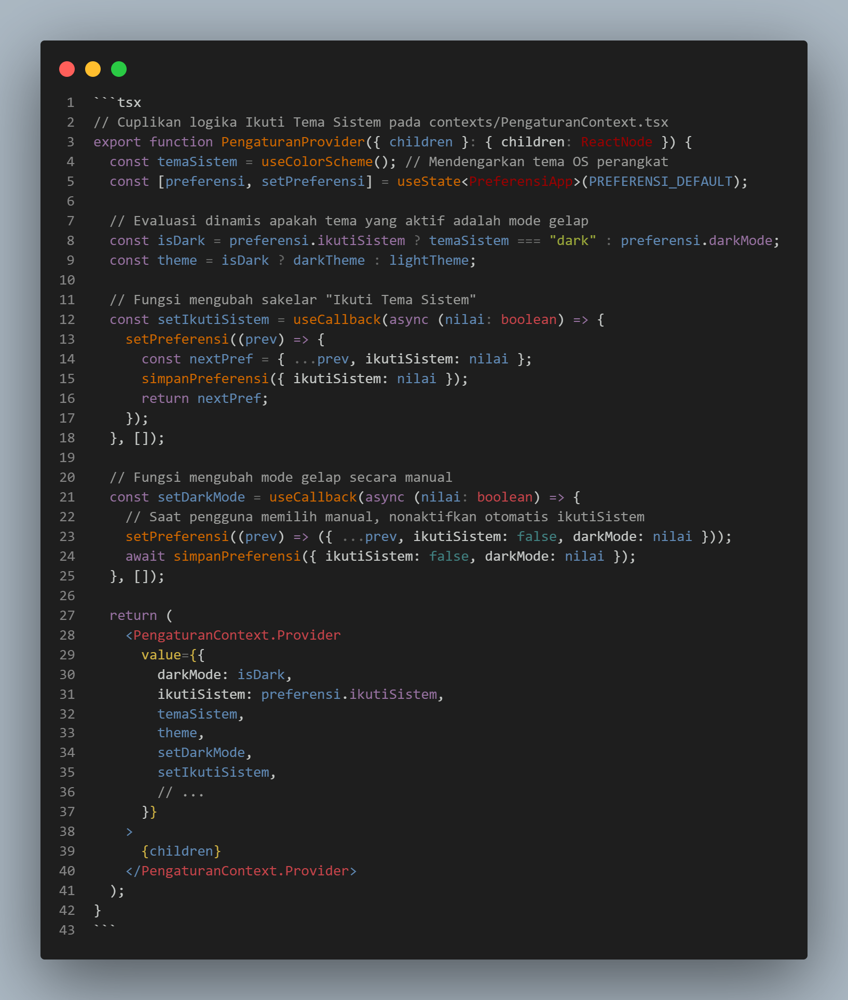

*Gambar 6.2: Tangkapan layar kode evaluasi tema sistem pada contexts/PengaturanContext.tsx*

</div>

Cuplikan teks kode program:

```tsx
// Cuplikan logika Ikuti Tema Sistem pada contexts/PengaturanContext.tsx
export function PengaturanProvider({ children }: { children: ReactNode }) {
  const temaSistem = useColorScheme(); // Mendengarkan tema OS perangkat
  const [preferensi, setPreferensi] = useState<PreferensiApp>(PREFERENSI_DEFAULT);

  // Evaluasi dinamis apakah tema yang aktif adalah mode gelap
  const isDark = preferensi.ikutiSistem ? temaSistem === "dark" : preferensi.darkMode;
  const theme = isDark ? darkTheme : lightTheme;

  // Fungsi mengubah sakelar "Ikuti Tema Sistem"
  const setIkutiSistem = useCallback(async (nilai: boolean) => {
    setPreferensi((prev) => {
      const nextPref = { ...prev, ikutiSistem: nilai };
      simpanPreferensi({ ikutiSistem: nilai });
      return nextPref;
    });
  }, []);

  // Fungsi mengubah mode gelap secara manual
  const setDarkMode = useCallback(async (nilai: boolean) => {
    // Saat pengguna memilih manual, nonaktifkan otomatis ikutiSistem
    setPreferensi((prev) => ({ ...prev, ikutiSistem: false, darkMode: nilai }));
    await simpanPreferensi({ ikutiSistem: false, darkMode: nilai });
  }, []);

  return (
    <PengaturanContext.Provider
      value={{
        darkMode: isDark,
        ikutiSistem: preferensi.ikutiSistem,
        temaSistem,
        theme,
        setDarkMode,
        setIkutiSistem,
        // ...
      }}
    >
      {children}
    </PengaturanContext.Provider>
  );
}
```

---

### 6.5 Antarmuka Pengaturan & Sakelar Ikuti Sistem (`app/(tabs)/pengaturan.tsx`)

Pada layar Pengaturan, antarmuka dirancang dengan UX yang intuitif untuk mencegah konflik preferensi:
- **Penguncian Sakelar (*Switch Disabled*)**: Ketika *Ikuti Tema Sistem* aktif, baris sakelar *Mode Gelap* secara otomatis terkunci (`disabled={ikutiSistem}`) dan tampilannya dibuat redup (`styles.rowDisabled`) untuk memberi tahu pengguna bahwa warna sedang dikendalikan oleh sistem.
- **Keterangan Status Dinamis**: Subtitle menampilkan status real-time, misalnya `"Otomatis (Gelap)"` atau `"Otomatis (Terang)"`.

Berikut adalah bukti visual tangkapan layar editor kode antarmuka pengaturan sakelar tema:

<div align="center">

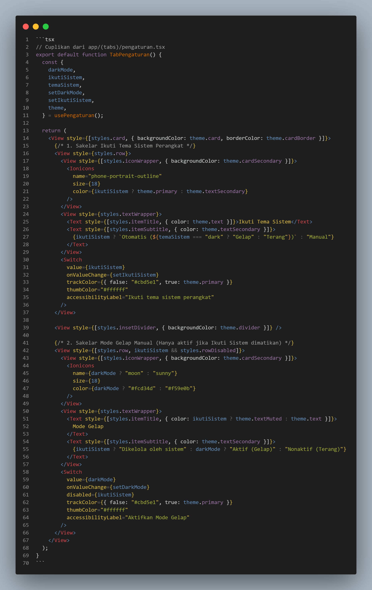

*Gambar 6.3: Tangkapan layar kode antarmuka pengaturan tema pada app/(tabs)/pengaturan.tsx*

</div>

Cuplikan teks kode program:

```tsx
// Cuplikan dari app/(tabs)/pengaturan.tsx
export default function TabPengaturan() {
  const {
    darkMode,
    ikutiSistem,
    temaSistem,
    setDarkMode,
    setIkutiSistem,
    theme,
  } = usePengaturan();

  return (
    <View style={[styles.card, { backgroundColor: theme.card, borderColor: theme.cardBorder }]}>
      {/* 1. Sakelar Ikuti Tema Sistem Perangkat */}
      <View style={styles.row}>
        <View style={[styles.iconWrapper, { backgroundColor: theme.cardSecondary }]}>
          <Ionicons
            name="phone-portrait-outline"
            size={18}
            color={ikutiSistem ? theme.primary : theme.textSecondary}
          />
        </View>
        <View style={styles.textWrapper}>
          <Text style={[styles.itemTitle, { color: theme.text }]}>Ikuti Tema Sistem</Text>
          <Text style={[styles.itemSubtitle, { color: theme.textSecondary }]}>
            {ikutiSistem ? `Otomatis (${temaSistem === "dark" ? "Gelap" : "Terang"})` : "Manual"}
          </Text>
        </View>
        <Switch
          value={ikutiSistem}
          onValueChange={setIkutiSistem}
          trackColor={{ false: "#cbd5e1", true: theme.primary }}
          thumbColor="#ffffff"
          accessibilityLabel="Ikuti tema sistem perangkat"
        />
      </View>

      <View style={[styles.insetDivider, { backgroundColor: theme.divider }]} />

      {/* 2. Sakelar Mode Gelap Manual (Hanya aktif jika Ikuti Sistem dimatikan) */}
      <View style={[styles.row, ikutiSistem && styles.rowDisabled]}>
        <View style={[styles.iconWrapper, { backgroundColor: theme.cardSecondary }]}>
          <Ionicons
            name={darkMode ? "moon" : "sunny"}
            size={18}
            color={darkMode ? "#fcd34d" : "#f59e0b"}
          />
        </View>
        <View style={styles.textWrapper}>
          <Text style={[styles.itemTitle, { color: ikutiSistem ? theme.textMuted : theme.text }]}>
            Mode Gelap
          </Text>
          <Text style={[styles.itemSubtitle, { color: theme.textSecondary }]}>
            {ikutiSistem ? "Dikelola oleh sistem" : darkMode ? "Aktif (Gelap)" : "Nonaktif (Terang)"}
          </Text>
        </View>
        <Switch
          value={darkMode}
          onValueChange={setDarkMode}
          disabled={ikutiSistem}
          trackColor={{ false: "#cbd5e1", true: theme.primary }}
          thumbColor="#ffffff"
          accessibilityLabel="Aktifkan Mode Gelap"
        />
      </View>
    </View>
  );
}
```

---

### 6.6 Tombol Sakelar Cepat di Pojok Kanan Atas Header (`AnimatedThemeToggle`)

Selain melalui menu Pengaturan, aplikasi juga menyediakan **Tombol Sakelar Cepat (*Quick Action Toggle*)** yang dipasang langsung pada pojok kanan atas (*headerRight*) di seluruh layar navigasi tab:

1. **Fungsi & Aksesibilitas**:
   - Memungkinkan pengguna mengubah tema kapan saja langsung dari layar Beranda, Aktivitas, maupun Tentang secara instan dengan satu kali ketukan, tanpa harus berpindah ke tab Pengaturan.
2. **Pemasangan pada Layout Navigasi (`app/(tabs)/_layout.tsx`)**:
   ```tsx
   // Cuplikan headerRight pada app/(tabs)/_layout.tsx
   headerRight: () => (
     <View style={{ marginRight: 16 }}>
       <AnimatedThemeToggle size="compact" />
     </View>
   ),
   ```
3. **Mekanisme Animasi & Transisi (`components/AnimatedThemeToggle.tsx`)**:
   - Komponen berbentuk pil kapsul dengan animasi fisik halus:
     - **Ibu Jari Bergeser (*Thumb Translation*)**: Berpindah secara mulus antara ikon Matahari (kiri) dan Bulan (kanan).
     - **Rotasi Ikon 360°**: Ikon berputar penuh saat tema berganti.
     - **Efek Transisi Melingkar (*Circular Reveal Animation*)**: Menghitung koordinat sentuhan jari pengguna (`pageX`, `pageY`) untuk memicu efek transisi warna melingkar ke seluruh layar.
   - **Override Otomatis**: Saat tombol cepat ini diketuk pengguna, sistem otomatis menonaktifkan `ikutiSistem: false` dan langsung membalikkan mode gelap (`darkMode: !isDark`) agar kehendak langsung pengguna diutamakan.

---

### 6.7 Tangkapan Layar Hasil Implementasi (Screenshots)

Berikut adalah bukti visual implementasi lengkap fitur tema dinamis (Pengaturan, Sakelar Cepat Header, Mode Terang, dan Mode Gelap):

<div align="center">

| Sakelar Cepat Header Kanan Atas | Menu Pengaturan Tema |
| :---: | :---: |
| 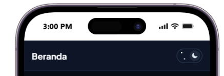 | 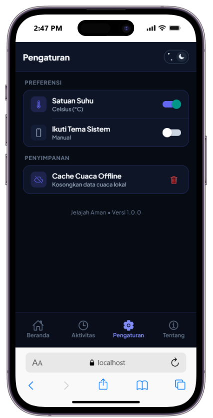 |
| *Gambar 6.4: Tombol sakelar cepat animasi matahari/bulan di kanan atas header* | *Gambar 6.5: Sakelar Ikuti Tema Sistem & Mode Gelap di menu Pengaturan* |

| Tampilan Beranda Mode Terang (*Light Mode*) | Tampilan Beranda Mode Gelap (*Atmospheric Dark*) |
| :---: | :---: |
|  | 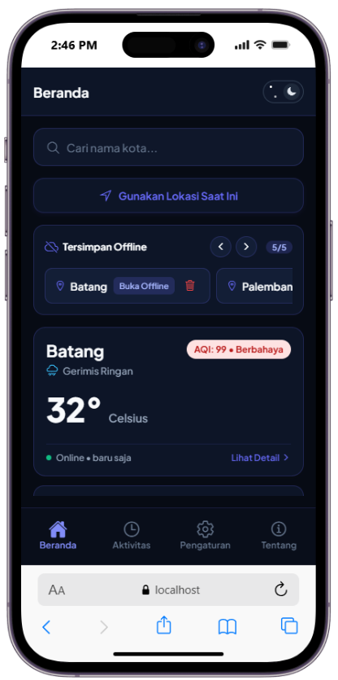 |
| *Gambar 6.6: Layar Beranda bertema Terang (Light Mode)* | *Gambar 6.7: Layar Beranda bertema Gelap Indigo (Dark Mode)* |

</div>

> [!NOTE]
> Seluruh aset tangkapan layar fitur tema dinamis di atas tersimpan pada: `docs/screenshots/04_header_theme_toggle.png`, `docs/screenshots/04_pengaturan_tema.png`, `docs/screenshots/04_tampilan_terang.png`, dan `docs/screenshots/04_tampilan_gelap.png`.

---

## BAB VII: FITUR TAMBAHAN & NILAI PLUS (KREATIVITAS MAHASISWA)

Sebagai wujud inovasi dan eksplorasi materi di luar batas minimum tugas UTS, mahasiswa menambahkan beberapa penyempurnaan unggulan:

### 7.1 Fitur Konversi Satuan Suhu Dinamis (Celsius vs Fahrenheit)
- **Kebutuhan & Fungsionalitas**: Aplikasi menyediakan fitur pemilihan satuan suhu antara **Celsius (°C)** dan **Fahrenheit (°F)** yang dapat diubah secara instan melalui sakelar di layar Pengaturan. Preferensi pengguna disimpan secara persisten ke dalam `AsyncStorage` (`@jelajah_aman:preferensi`) dan langsung memicu pembaruan reaktif (*reactive state update*) ke seluruh kartu cuaca baik di layar Beranda maupun Detail Cuaca.
- **Formulasi Matematika**: Menggunakan fungsi konversi matematis presisi:
  $$\text{Suhu (°F)} = \text{round}\left( \text{Suhu (°C)} \times \frac{9}{5} + 32 \right)$$
  Sebagai bukti visual nyata pada tangkapan layar, suhu kota Batang sebesar **$32^\circ\text{C}$** dikonversi secara akurat menjadi **$89^\circ\text{F}$** ($32 \times 1.8 + 32 = 89.6 \approx 89^\circ\text{F}$).
- **Potongan Kode Logika Konversi (`contexts/PengaturanContext.tsx`)**:

Berikut adalah bukti visual tangkapan layar editor kode implementasi fungsi konversi suhu:

<div align="center">

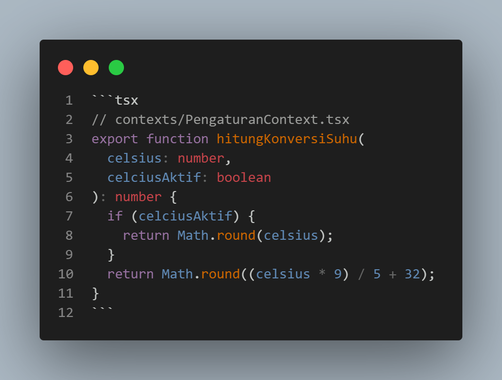

*Gambar 7.1: Tangkapan layar kode fungsi konversi suhu hitungKonversiSuhu pada contexts/PengaturanContext.tsx*

</div>

Cuplikan teks kode program:

```tsx
// contexts/PengaturanContext.tsx
export function hitungKonversiSuhu(
  celsius: number,
  celciusAktif: boolean
): number {
  if (celciusAktif) {
    return Math.round(celsius);
  }
  return Math.round((celsius * 9) / 5 + 32);
}
```

- **Penerapan pada Komponen Antarmuka (`components/WeatherCard.tsx`)**:

Berikut adalah bukti visual tangkapan layar editor kode render satuan suhu dinamis:

<div align="center">

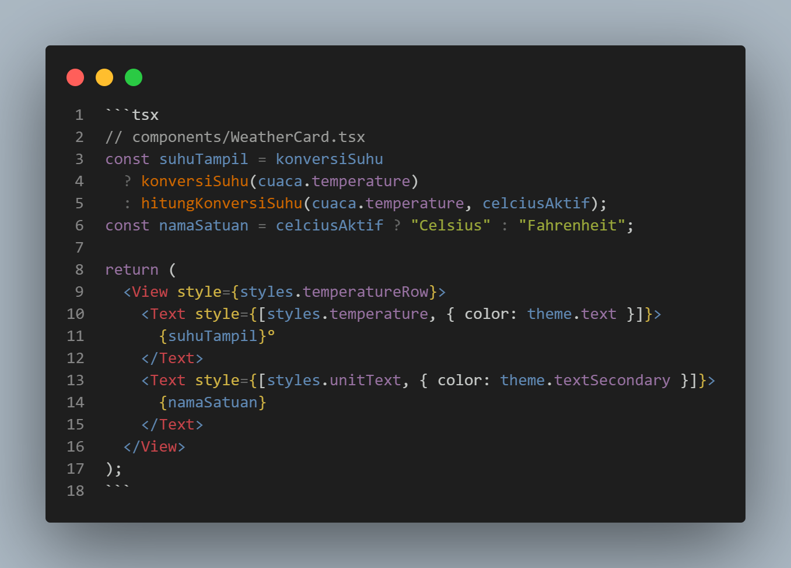

*Gambar 7.2: Tangkapan layar kode render suhu dinamis pada components/WeatherCard.tsx*

</div>

Cuplikan teks kode program:

```tsx
// components/WeatherCard.tsx
const suhuTampil = konversiSuhu
  ? konversiSuhu(cuaca.temperature)
  : hitungKonversiSuhu(cuaca.temperature, celciusAktif);
const namaSatuan = celciusAktif ? "Celsius" : "Fahrenheit";

return (
  <View style={styles.temperatureRow}>
    <Text style={[styles.temperature, { color: theme.text }]}>
      {suhuTampil}°
    </Text>
    <Text style={[styles.unitText, { color: theme.textSecondary }]}>
      {namaSatuan}
    </Text>
  </View>
);
```

### 7.2 Tipografi Kustom Modern (Google Fonts: Plus Jakarta Sans)
- Mengintegrasikan pustaka `@expo-google-fonts/plus-jakarta-sans` dengan 5 bobot lengkap: `Regular (400)`, `Medium (500)`, `SemiBold (600)`, `Bold (700)`, dan `ExtraBold (800)`.
- Mengonfigurasi `SplashScreen.preventAutoHideAsync()` di root layout (`app/_layout.tsx`) agar font ter-load sempurna sebelum antarmuka dirender.
- **Pembersihan Bentrok Android `fontWeight`**: Menghapus redundansi `fontWeight` pada komponen yang telah menggunakan `fontFamily` khusus bobot tertentu, sehingga Android tidak mengalami *fallback* ke font sistem bawaan (Roboto) melainkan murni menampilkan tipografi Plus Jakarta Sans yang tajam dan elegan.

Berikut adalah bukti visual tangkapan layar editor kode konfigurasi font kustom:

<div align="center">

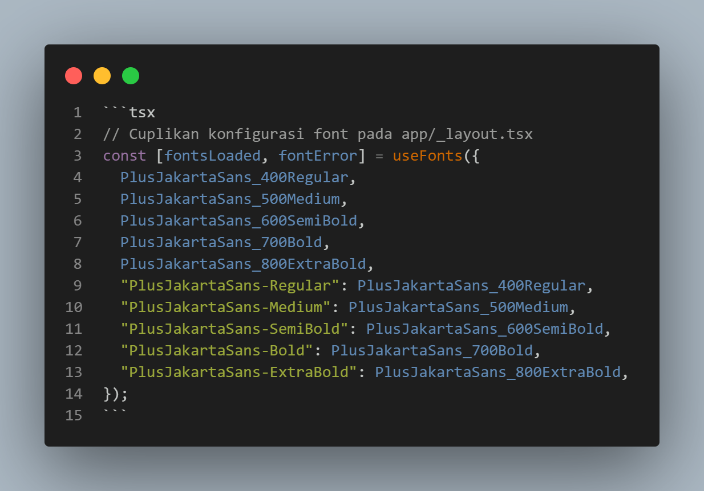

*Gambar 7.3: Tangkapan layar kode inisialisasi font Plus Jakarta Sans pada app/_layout.tsx*

</div>

Cuplikan teks kode program:

```tsx
// Cuplikan konfigurasi font pada app/_layout.tsx
const [fontsLoaded, fontError] = useFonts({
  PlusJakartaSans_400Regular,
  PlusJakartaSans_500Medium,
  PlusJakartaSans_600SemiBold,
  PlusJakartaSans_700Bold,
  PlusJakartaSans_800ExtraBold,
  "PlusJakartaSans-Regular": PlusJakartaSans_400Regular,
  "PlusJakartaSans-Medium": PlusJakartaSans_500Medium,
  "PlusJakartaSans-SemiBold": PlusJakartaSans_600SemiBold,
  "PlusJakartaSans-Bold": PlusJakartaSans_700Bold,
  "PlusJakartaSans-ExtraBold": PlusJakartaSans_800ExtraBold,
});
```

### 7.3 Palet Warna "Atmospheric Indigo & Electric Sky"
- Menggantikan warna biru standar generic (`#2563eb`) dengan palet bernuansa atmosfer cuaca internasional: **Indigo `#4F46E5`** dan **Electric Sky `#0EA5E9`**.
- Pada Mode Gelap, kartu aplikasi menggunakan latar **Deep Twilight `#0D1527`** dengan garis tepi **Indigo Glow `rgba(99, 102, 241, 0.22)`** yang memberikan kesan aplikasi kelas atas (*premium tech aesthetic*).

### 7.4 Status Data Terpadu Minimalis
- Menyematkan badge status data pada kartu cuaca (`WeatherCard.tsx`):
  - **Online (Hijau Emerald)**: Data segar diambil langsung dari API internet.
  - **Tersimpan (Biru Langit)**: Data tersimpan di SQLite lokal dalam batas waktu segar.
  - **Offline (Kuning Amber)**: Data cache lokal saat perangkat sedang tidak memiliki koneksi internet.

### 7.5 Penjaminan Mutu & Type-Safety
- Seluruh kode program diverifikasi secara berkala menggunakan kompilator TypeScript (`npx tsc --noEmit`) dan menghasilkan **0 error** (*Clean Compile*).

### 7.6 Tangkapan Layar Hasil Implementasi (Screenshots)

Berikut adalah bukti visual implementasi fitur kreativitas mahasiswa (Konversi Suhu Fahrenheit, Tipografi Plus Jakarta Sans, Dialog Modal Tema Gelap, dan Indikator Status Data):

<div align="center">

| Konversi Suhu Fahrenheit ($89^\circ\text{F}$) & Tipografi | Modal Dialog Tambah Favorit (*Dark Theme*) | Indikator Status Data (*Online / Tersimpan*) |
| :---: | :---: | :---: |
| 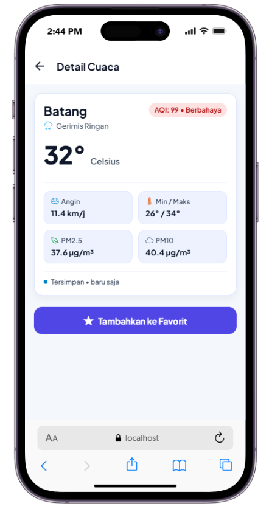 | 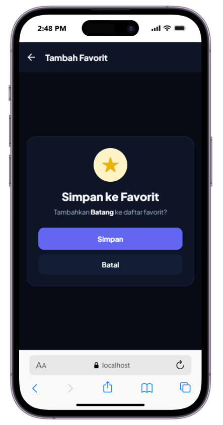 | 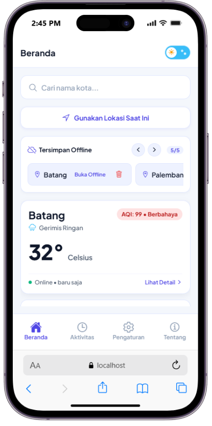 |
| *Gambar 7.4: Suhu 89° Fahrenheit hasil konversi dari 32°C & Plus Jakarta Sans* | *Gambar 7.5: Modal Tambah Favorit dalam Mode Gelap* | *Gambar 7.6: Status data Online & Tersimpan pada Beranda* |

</div>

```bash
# Verifikasi Kualitas Kode & Type-Safety:
$ npx tsc --noEmit
# Exit Code: 0 (Clean Compile - Bebas dari seluruh kesalahan pengetikan tipe TypeScript)
```

> [!NOTE]
> Seluruh aset tangkapan layar di atas tersimpan secara persisten pada direktori repositori: `docs/screenshots/`.

---

## BAB VIII: RIWAYAT COMMIT GIT (28++ COMMITS)

Pengembangan dilakukan secara disiplin dan bertahap dengan menerapkan standar **Conventional Commits** (`feat:`, `style:`, `refactor:`, `fix:`). Berikut adalah bukti visual tangkapan layar riwayat commit aktual pada repositori GitHub:

<div align="center">


*Gambar 8.1: Tangkapan layar riwayat commit Git pada repositori GitHub*

</div>

Daftar rincian teks commit hash dan deskripsi:

```bash
da13d7c style(beranda): perbarui tombol favorit dan modal konfirmasi dengan palet indigo
5fa5b4a style(beranda): selaraskan tombol deteksi GPS dan tombol perbarui dengan Atmospheric Indigo
f1d90ae style(beranda): terapkan typography Plus Jakarta Sans pada hasil pencarian Beranda
34c7b57 style(favorit): terapkan tema Atmospheric Indigo dan font kustom pada modal Tambah Favorit
f8aa232 style(detail): terapkan Plus Jakarta Sans dan warna tema pada halaman Detail
e74d259 style(tentang): selaraskan ikon hero dan typography pada halaman Tentang
4f3694e style(riwayat): selaraskan ikon riwayat dan bersihkan fontWeight pada modal dialog
bfe6c28 style(pengaturan): selaraskan switch dan ikon cache dengan Atmospheric Indigo
d7c0111 style(indikator-aqi): terapkan Plus Jakarta Sans pada komponen IndikatorAQI
5d84c1f style(riwayat-list): terapkan Plus Jakarta Sans dan warna tema pada RiwayatList
2b0d8a1 style(atribusi): terapkan Plus Jakarta Sans Medium pada teks atribusi Open-Meteo
6a8f741 style(status-data): selaraskan status data online dengan Atmospheric Indigo dan font kustom
211d63a style(weather-card): hilangkan redundansi fontWeight untuk render optimal di Android
f1ccd5b style(search): terapkan Plus Jakarta Sans Medium pada input pencarian SearchBox
712662e style(tabs): selaraskan header tab dan tab bar dengan Plus Jakarta Sans
aba9a11 style(root): tambahkan fallback font default global dan selaraskan root header
175f940 style(theme): perbarui token palet ke Atmospheric Indigo dan Electric Sky
0868fec refactor(pengaturan): hilangkan garis pembatas dan chevron pada tombol hapus cache
86513ae style(pengaturan): terapkan typography Plus Jakarta Sans pada seluruh elemen pengaturan
db10eb3 feat(pengaturan): pasang action group tempat sampah, pembatas, dan chevron pada cache
9532123 refactor(pengaturan): hapus opsi notifikasi cuaca buruk untuk tata letak lebih ringkas
77a6e6f refactor(pengaturan): sederhanakan seksi preferensi dan judul header
ca35266 style(tentang): terapkan tipografi Plus Jakarta Sans pada kartu informasi pengembang
fa2d76d style(riwayat): terapkan tipografi Plus Jakarta Sans pada modal konfirmasi hapus
c4e3651 style(riwayat): terapkan tipografi Plus Jakarta Sans pada kartu riwayat dan koordinat
37e96b3 style(riwayat): terapkan tipografi Plus Jakarta Sans pada judul seksi dan badge
... (Total lebih dari 28 commit aktif pada repositori main)
```

---

## BAB IX: KESIMPULAN & PENUTUP

### 9.1 Kesimpulan
Seluruh target penugasan Ujian Tengah Semester (UTS) mata kuliah Pemrograman Berbasis Platform telah berhasil diselesaikan dengan baik dan teruji secara fungsional pada platform Android (Expo Go) maupun Web Browser:
1. **Ikon Tab Bar**: Tampil modern dan representatif dengan `@expo/vector-icons` (`Ionicons`) dengan pemisahan status aktif dan non-aktif serta label navigasi yang rapi.
2. **Riwayat Pencarian**: Berjalan otomatis dengan batas 10 kota, terhindar dari duplikasi data (*deduplicated*), tersimpan persisten di `AsyncStorage`, dan dapat diklik untuk meninjau data cuaca.
3. **Penghapusan Cache**: Tersedia tombol hapus spesifik pada setiap rekaman cache kota di SQLite, dilengkapi dengan modal konfirmasi interaktif sebelum penghapusan data.
4. **Tema Gelap / Terang**: Mendukung mode Terang, Gelap, dan Otomatis Mengikuti Sistem perangkat dengan perpindahan warna dinamis pada seluruh komponen.
5. **Konversi Satuan Suhu (Nilai Plus)**: Mengimplementasikan sakelar preferensi satuan suhu dinamis dari Celsius (°C) ke Fahrenheit (°F) berbasis rumus matematika presisi yang tersimpan persisten di storage dan bereaksi langsung pada seluruh kartu cuaca.
6. **Kualitas & Kreativitas Tambahan**: Dilengkapi tipografi Google Fonts **Plus Jakarta Sans**, palet visual modern **Atmospheric Indigo & Electric Sky**, modal dialog custom bergaya twilight, serta arsitektur kode TypeScript yang bebas dari galat (*0 error Clean Compile*).

Laporan ini disusun dengan sebenar-benarnya berdasarkan kode program riil yang terdapat pada repositori proyek.

---

## BAB X: DAFTAR PUSTAKA

1. **Expo Documentation**. (2026). *Expo SDK 57: Universal Native Apps with React*. Diakses dari: https://docs.expo.dev/versions/v57.0.0/
2. **React Native Core Team**. (2026). *React Native Architecture & Components*. Meta Open Source. Diakses dari: https://reactnative.dev/docs/getting-started
3. **Open-Meteo GmbH**. (2026). *Free Weather & Air Quality API Documentation*. Diakses dari: https://open-meteo.com/en/docs
4. **Expo SQLite Team**. (2026). *Expo SQLite Next: Fast Offline-First Database for Mobile*. Diakses dari: https://docs.expo.dev/versions/v57.0.0/sdk/sqlite/
5. **React Navigation & Expo Router**. (2026). *File-Based Routing for React Native*. Software Mansion & Expo. Diakses dari: https://docs.expo.dev/router/introduction/
6. **Tokopedia Design & Google Fonts**. (2020). *Plus Jakarta Sans: Clean Geometric Sans-Serif Typeface*. Diakses dari: https://fonts.google.com/specimen/Plus+Jakarta+Sans
7. **AsyncStorage Team**. (2026). *Async Storage for React Native*. React Native Community. Diakses dari: https://react-native-async-storage.github.io/async-storage/

---

*Pekalongan, 21 Oktober 2026*  
**Mahasiswa Penyusun,**

**Gathan Hilabi**  
NIM: 60324059
